# Pediatric ITP chronicity: integrated variant x expression analysis - results

_Generated 2026-10-25 15:37 UTC by the automated pipeline (commit `cdc51f8`, R version 4.6.1 (2026-06-24))._

> Everything below is produced by code in this repository from public data. Numbers are recomputed
> on every run; interpretation sentences marked **[auto]** are generated from the numbers, not written by hand.

## 0. Pipeline status

| step | script | status | minutes | message |
|---|---|---|---|---|
| 00 | R/00_audit.R | ok | 0.9 |  |
| 01 | R/01_expression.R | ok | 7.2 |  |
| 02 | R/02_differential_expression.R | ok | 0.1 |  |
| 03 | R/03_modules_enrichment.R | ok | 0.7 |  |
| 04 | R/04_novel_genes.R | ok | 0.1 |  |
| 10 | R/10_gwas.R | ok | 9.2 |  |
| 11 | R/11_twas.R | ok | 2.9 |  |
| 12 | R/12_coloc.R | ok | 8 |  |
| 13 | R/13_replication.R | ok | 0 |  |
| 20 | R/20_integration.R | ok | 0 |  |
| 21 | R/21_benchmark.R | ok | 0.9 |  |

## 1. Data audit

### Metadata completeness and variant-callability

| gse | platform | platform_title | technology | n_samples | characteristics_fields | has_age | has_sex | has_platelet_count | has_treatment | has_timing | has_outcome | sequence_reads | gatk_variant_callable | reason |
|---|---|---|---|---|---|---|---|---|---|---|---|---|---|---|
| GSE46922 | GPL570 | [HG-U133_Plus_2] Affymetrix Human Genome U133 Plus 2.0 Array | in situ oligonucleotide |   13 | disease state; tissue; cell type | FALSE | FALSE | FALSE | FALSE | FALSE | FALSE | FALSE | FALSE | intensity/ratio microarray: measures mRNA abundance, never reads DNA sequence |
| GSE56232 | GPL570 | [HG-U133_Plus_2] Affymetrix Human Genome U133 Plus 2.0 Array | in situ oligonucleotide |   12 | group | FALSE | FALSE | FALSE | FALSE | FALSE | TRUE | FALSE | FALSE | intensity/ratio microarray: measures mRNA abundance, never reads DNA sequence |
| GSE23754 | GPL10845 | SFGF Human 41K cDNA array (print batches: SHGO and SHEB) | spotted DNA/cDNA |   26 | patient; tissue; disease; disease state; reference | FALSE | FALSE | FALSE | FALSE | TRUE | TRUE | FALSE | FALSE | intensity/ratio microarray: measures mRNA abundance, never reads DNA sequence |

No dataset contains sequencing reads, so none is variant-callable with GATK; the variant layer therefore
uses published GWAS summary statistics.

### Group sizes

| gse | group | n | n_not_duplicated_elsewhere |
|---|---|---|---|
| GSE46922 | ND |    7 |    7 |
| GSE46922 | chronic |    6 |    6 |
| GSE56232 | ND |    6 |    2 |
| GSE56232 | remission |    6 |    6 |
| GSE23754 | acute |    8 |    8 |
| GSE23754 | progression |    4 |    4 |
| GSE23754 | chronic |   14 |   14 |

### Byte-identical raw arrays shared between series

| canonical_gsm | gsm | gse | title | canonical_gse | canonical_title |
|---|---|---|---|---|---|
| GSM1141222 | GSM1357436 | GSE56232 | peripheral blood T-cells newly diagnosed ITP1 | GSE46922 | peripheral blood T-cells of with newly diagnosed ITP 6 |
| GSM1141223 | GSM1357437 | GSE56232 | peripheral blood T-cells newly diagnosed ITP2 | GSE46922 | peripheral blood T-cells of with newly diagnosed ITP 7 |
| GSM1141224 | GSM1357438 | GSE56232 | peripheral blood T-cells newly diagnosed ITP3 | GSE46922 | peripheral blood T-cells of with newly diagnosed ITP 4 |
| GSM1141225 | GSM1357434 | GSE56232 | peripheral blood T-cells newly diagnosed ITP6 | GSE46922 | peripheral blood T-cells of with newly diagnosed ITP 2 |

**[auto]** 
4 raw CEL files deposited in one series are exact copies of files in another, under different patient numbers. They are counted once in every pooled analysis; papers that merged GSE46922 with GSE56232 without checking would have double-counted these children.

## 2. Expression layer

### Probe re-annotation (GEO GPL570 table vs exact probe-sequence matches to GENCODE v50)

| status | N |
|---|---|
| unchanged | 30524 |
| lost: probes no longer match a transcript | 7245 |
| unmapped_both | 6984 |
| reassigned to a different gene | 3593 |
| lost: probes now hit several genes | 2307 |
| same gene, renamed | 2113 |
| recovered (no GPL570 symbol, now maps) | 1502 |
| unmapped: probes hit several genes |  407 |

Biotypes of genes that become measurable only under the current annotation:

| biotype | N |
|---|---|
| lncRNA | 2652 |
| protein_coding |  224 |
| TEC |  176 |
| processed_pseudogene |   78 |
| TR_V_gene |   21 |
| unprocessed_pseudogene |    6 |
| transcribed_unprocessed_pseudogene |    4 |
| IG_V_gene |    4 |
| transcribed_unitary_pseudogene |    2 |
| TR_V_pseudogene |    1 |

GSE23754 clone re-annotation:

| status | N |
|---|---|
| unchanged | 21024 |
| unannotated clone | 7450 |
| renamed | 6197 |
| lost / withdrawn |  622 |

**Batch handling:** ComBat applied (batch = series, disease group protected)

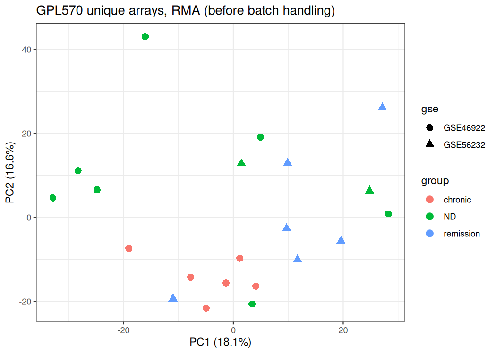

### Confounders estimated from expression

Kruskal-Wallis test of each score against disease group. A small p here means that score differs between
groups and any gene correlated with it will look 'differentially expressed' for that reason alone.

| cohort | score | kruskal_p | median_chronic | median_ND | median_remission | median_acute | median_progression |
|---|---|---|---|---|---|---|---|
| GSE46922 | platelet | 0.199 | -0.34 | 0.245 | NA | NA | NA |
| GSE46922 | glucocorticoid | 0.253 | 0.346 | -0.208 | NA | NA | NA |
| GSE46922 | interferon | 0.391 | -0.418 | -0.286 | NA | NA | NA |
| GSE46922 | t_cell | 0.0321 | -0.492 | -0.0575 | NA | NA | NA |
| GSE46922 | b_cell | 0.668 | 0.06 | 0.243 | NA | NA | NA |
| GSE46922 | nk_cell | 0.775 | 0.142 | 0.0806 | NA | NA | NA |
| GSE46922 | monocyte | 0.0633 | -0.632 | 0.394 | NA | NA | NA |
| GSE46922 | neutrophil | 0.391 | -0.715 | -0.0632 | NA | NA | NA |
| GSE46922 | erythroid | 0.0152 | -0.513 | 0.126 | NA | NA | NA |
| GSE46922 | sex_score | 0.0865 | 2.01 | -1.62 | NA | NA | NA |
| GSE56232 | platelet | 0.0374 | NA | 0.206 | -0.621 | NA | NA |
| GSE56232 | glucocorticoid | 0.423 | NA | 0.363 | -0.125 | NA | NA |
| GSE56232 | interferon | 0.631 | NA | -0.231 | -0.221 | NA | NA |
| GSE56232 | t_cell | 0.749 | NA | 0.0376 | 0.0567 | NA | NA |
| GSE56232 | b_cell | 0.337 | NA | 0.456 | -0.84 | NA | NA |
| GSE56232 | nk_cell | 0.873 | NA | -0.127 | 0.0889 | NA | NA |
| GSE56232 | monocyte | 0.337 | NA | 0.44 | 0.14 | NA | NA |
| GSE56232 | neutrophil | 0.522 | NA | -0.124 | 0.553 | NA | NA |
| GSE56232 | erythroid | 0.025 | NA | 0.378 | -0.413 | NA | NA |
| GSE56232 | sex_score | 0.749 | NA | -1.62 | -1.55 | NA | NA |
| GSE23754 | platelet | 0.231 | 0.207 | NA | NA | -0.229 | 0.398 |
| GSE23754 | glucocorticoid | 0.0745 | 0.0968 | NA | NA | -0.435 | 0.0355 |
| GSE23754 | interferon | 0.929 | -0.18 | NA | NA | -0.384 | 0.123 |
| GSE23754 | t_cell | 0.976 | 0.125 | NA | NA | 0.0768 | 0.0682 |
| GSE23754 | b_cell | 0.138 | -0.313 | NA | NA | 0.0435 | 0.754 |
| GSE23754 | nk_cell | 0.527 | 0.0302 | NA | NA | -0.129 | 0.284 |
| GSE23754 | monocyte | 0.622 | 0.184 | NA | NA | -0.461 | 0.216 |
| GSE23754 | neutrophil | 0.397 | 0.351 | NA | NA | -0.586 | 0.441 |
| GSE23754 | erythroid | 0.398 | -0.138 | NA | NA | 0.106 | 0.273 |
| GSE23754 | sex_score | 0.172 | -1.54 | NA | NA | 1.29 | -0.646 |

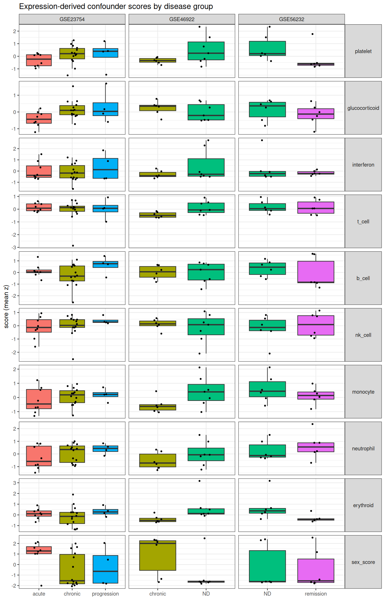

### Differential expression

`ratio_vs_null` = genes at p<0.05 divided by the number expected by chance (5% of genes tested).
Values near 1 mean the contrast is indistinguishable from noise at this sample size.

| cohort | contrast | model | n_genes | n_p05 | n_fdr | n | df_resid | covariates | ratio_vs_null |
|---|---|---|---|---|---|---|---|---|---|
| GSE23754 | progression_vs_acute | unadjusted | 13474 |  582 | 0 |   26 |   23 |  | 0.86 |
| GSE23754 | chronic_vs_acute | unadjusted | 13474 | 1399 | 0 |   26 |   23 |  | 2.08 |
| GSE23754 | progression_vs_acute | adjusted | 13474 |  312 | 0 |   26 |   21 | platelet+sex | 0.46 |
| GSE23754 | chronic_vs_acute | adjusted | 13474 |  296 | 0 |   26 |   21 | platelet+sex | 0.44 |
| GSE23754 | progression_vs_acute | sensitivity_glucocorticoid | 13474 |  316 | 0 |   26 |   20 | platelet+sex+glucocorticoid | 0.47 |
| GSE23754 | chronic_vs_acute | sensitivity_glucocorticoid | 13474 |  257 | 0 |   26 |   20 | platelet+sex+glucocorticoid | 0.38 |
| GSE46922 | chronic_vs_ND | unadjusted | 20103 | 3394 |  647 |   13 |   11 |  | 3.38 |
| GSE46922 | chronic_vs_ND | adjusted | 20103 | 3173 |  663 |   13 |   10 | sex | 3.16 |
| GSE46922 | chronic_vs_ND | sensitivity_glucocorticoid | 20103 | 3402 |  717 |   13 |    9 | sex+glucocorticoid | 3.38 |
| GSE56232 | remission_vs_ND | unadjusted | 20103 | 3915 |  836 |   12 |    5 | subject | 3.89 |
| GSE56232 | remission_vs_ND | adjusted | 20103 | 3915 |  836 |   12 |    5 | subject | 3.89 |
| GSE56232 | remission_vs_ND | sensitivity_glucocorticoid | 20103 | 3150 |  138 |   12 |    4 | subject+glucocorticoid | 3.13 |

Artefact check (fraction of the top-100 genes strongly correlated, |r|>0.6, with the platelet or steroid score):

| cohort | contrast | model | top100_frac_platelet_correlated | top100_frac_steroid_correlated | platelet_marker_genes_in_top100 |
|---|---|---|---|---|---|
| GSE23754 | progression_vs_acute | unadjusted | 0 |  0.2 | 0 |
| GSE23754 | progression_vs_acute | adjusted | 0 | 0.05 | 0 |
| GSE23754 | chronic_vs_acute | unadjusted | 0 | 0.21 | 0 |
| GSE23754 | chronic_vs_acute | adjusted | 0 | 0.05 | 0 |
| GSE46922 | chronic_vs_ND | unadjusted | 0.28 | 0 | 0 |
| GSE46922 | chronic_vs_ND | adjusted | 0.05 | 0 | 0 |
| GSE56232 | remission_vs_ND | unadjusted | 0.02 | 0.03 | 0 |
| GSE56232 | remission_vs_ND | adjusted | 0.02 | 0.03 | 0 |

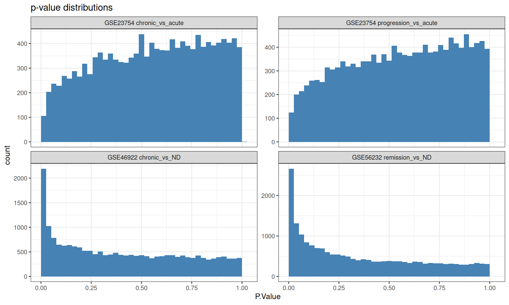

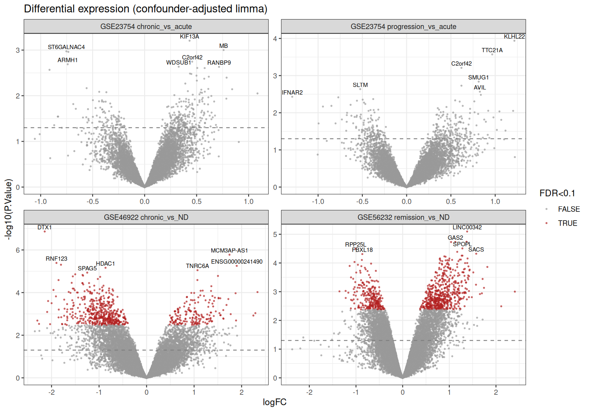

### Co-expression modules

13 modules (soft power 12). Cross-cohort behaviour of each module:

| module | n_genes | n_genes_on_cdna | GSE46922_chronic_minus_ND | GSE46922_p | GSE56232_remission_minus_ND | GSE56232_paired_p | GSE23754_progression_minus_acute | GSE23754_progression_p | GSE23754_chronic_minus_acute | GSE23754_chronic_p | concordant |
|---|---|---|---|---|---|---|---|---|---|---|---|
| pink |  216 |  154 | 1.16 | 0.00341 | 0.842 | 0.0592 | -0.034 | 0.799 | -0.0783 | 0.29 | FALSE |
| blue | 1136 |  845 | -0.817 | 0.0124 | -0.605 | 0.295 | 0.198 | 0.671 | 0.218 | 0.562 | FALSE |
| green |  286 |  209 | -0.839 | 0.0124 | -1.15 | 0.0592 | 0.206 | 0.445 | 0.279 | 0.162 | FALSE |
| salmon |   40 |   24 | 1.19 | 0.0268 | -0.0366 |    1 | -0.297 | 0.107 | -0.382 | 0.0605 | FALSE |
| greenyellow |  114 |   58 | 0.777 | 0.0268 | 0.445 | 0.208 | -0.1 | 0.799 | 0.0839 | 0.0705 | FALSE |
| yellow |  389 |  291 | -0.438 | 0.0538 | -0.194 | 0.402 | 0.392 | 0.149 | 0.345 | 0.0374 | FALSE |
| black |  222 |  136 | 1.32 | 0.0741 | 0.26 | 0.529 | -0.0637 | 0.932 | 0.00145 | 0.707 | FALSE |
| tan |   92 |   67 | -0.319 |  0.1 | 0.233 | 0.529 | -0.0987 | 0.552 | -0.0199 | 0.865 | TRUE |
| purple |  144 |   68 | 0.587 |  0.1 | -0.22 |    1 | 0.171 | 0.35 | 0.198 | 0.142 | TRUE |
| turquoise | 1213 |  913 | 0.534 | 0.225 | 0.829 | 0.036 | -0.0995 | 0.552 | -0.0819 | 0.609 | FALSE |
| red |  269 |  202 | -0.208 | 0.83 | -0.548 |    1 | 0.112 | 0.203 | -0.0919 | 0.207 | FALSE |
| brown |  489 |  316 | -0.394 | 0.83 | -0.624 | 0.036 | 0.191 | 0.35 | 0.152 | 0.142 | FALSE |
| magenta |  162 |  123 | 0.29 | 0.83 | 0.0792 | 0.834 | -0.00475 | 0.932 | 0.00117 |    1 | FALSE |

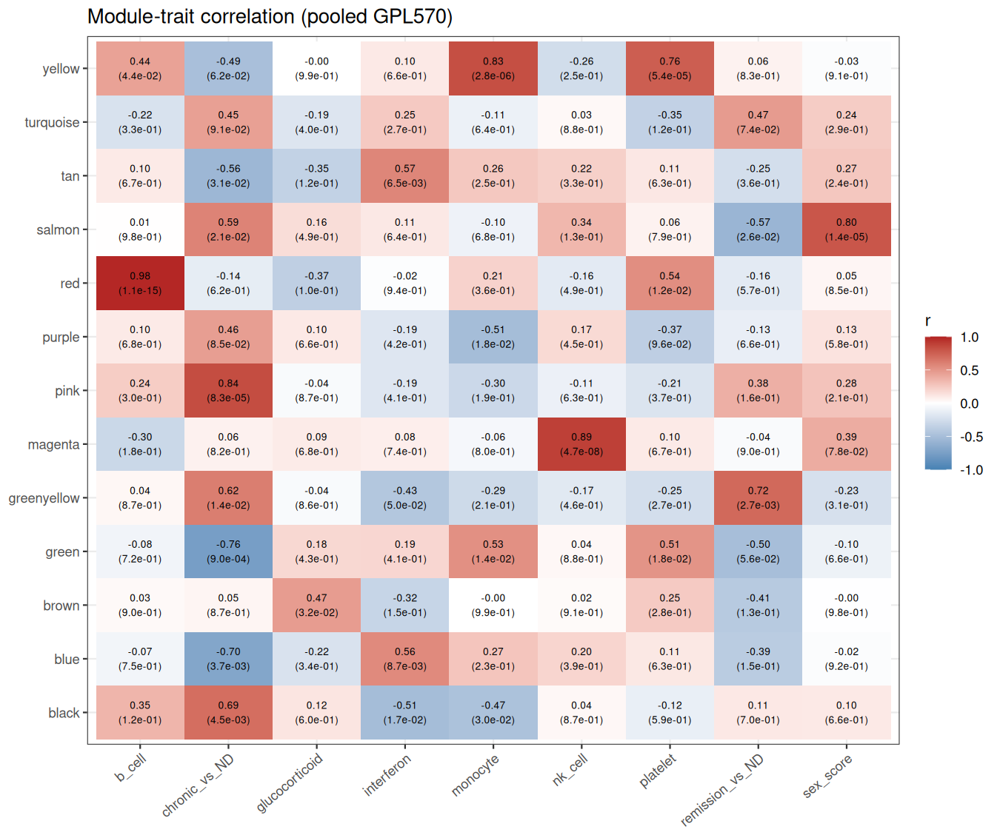

### Genes measurable only after re-annotation

The chronic-vs-newly-diagnosed T-cell difference was reported by Jernås et al. 2013; genes that no GPL570 probe set
was assigned to under the GEO annotation (renames excluded) are the part the original analysis could not see.
_robust_ = FDR < 0.1 in both the adjusted and steroid-sensitivity models, expression above the lowest quartile, and
at least half the probe set's probes matching the gene uniquely.

| contrast | genes_tested | fdr_hits | new_genes_tested | new_gene_hits | new_lncRNA_hits | robust_new_hits | robust_new_hits_reversing | fisher_p_new_enriched | odds_ratio |
|---|---|---|---|---|---|---|---|---|---|
| chronic_vs_ND | 20103 |  663 | 3007 |   32 |   25 |   30 |    3 |    1 | 0.281 |
| remission_vs_ND | 20103 |  836 | 3007 |   49 |   40 |    6 | 0 |    1 | 0.343 |

| contrast | symbol | gene_id | biotype | logFC | AveExpr | P.Value | adj.P.Val | fdr_steroid_model | best_probe_support | reverses_on_remission | robust |
|---|---|---|---|---|---|---|---|---|---|---|---|
| chronic_vs_ND | ENSG00000241490 | ENSG00000241490 | lncRNA |  1.9 | 3.33 | 5.57e-06 | 0.0224 | 0.04 | 0.909 | FALSE | TRUE |
| chronic_vs_ND | ENSG00000289519 | ENSG00000289519 | lncRNA | 1.87 | 4.99 | 1.07e-04 | 0.0364 | 0.04 |    1 | FALSE | TRUE |
| chronic_vs_ND | NA | ENSG00000275536 | unknown | 1.13 | 4.03 | 1.34e-04 | 0.0416 | 0.0447 |    1 | FALSE | TRUE |
| chronic_vs_ND | ENSG00000271533 | ENSG00000271533 | lncRNA | 1.39 | 4.29 | 1.45e-04 | 0.0423 | 0.0488 | 0.909 | FALSE | TRUE |
| chronic_vs_ND | ENSG00000267152 | ENSG00000267152 | lncRNA | 1.44 | 2.86 | 1.72e-04 | 0.0423 | 0.0499 |    1 | FALSE | TRUE |
| chronic_vs_ND | ENSG00000261799 | ENSG00000261799 | lncRNA | 1.51 | 5.15 | 1.77e-04 | 0.0423 | 0.04 | 0.727 | FALSE | TRUE |
| chronic_vs_ND | ENSG00000227782 | ENSG00000227782 | lncRNA | 1.33 | 5.24 | 2.21e-04 | 0.0429 | 0.04 |    1 | TRUE | TRUE |
| chronic_vs_ND | SMIM27 | ENSG00000235453 | protein_coding | -1.02 | 4.85 | 3.44e-04 | 0.0482 | 0.0459 |    1 | FALSE | TRUE |
| chronic_vs_ND | ENSG00000225300 | ENSG00000225300 | lncRNA | 1.68 | 2.15 | 3.82e-04 | 0.0512 | 0.0612 | 0.818 | FALSE | TRUE |
| chronic_vs_ND | ENSG00000272144 | ENSG00000272144 | lncRNA |  1.3 | 3.51 | 4.66e-04 | 0.0551 | 0.0579 | 0.545 | FALSE | TRUE |
| chronic_vs_ND | GVQW3 | ENSG00000179240 | protein_coding | 0.876 | 2.87 | 6.28e-04 | 0.0625 | 0.04 |    1 | FALSE | TRUE |
| chronic_vs_ND | ENSG00000272420 | ENSG00000272420 | lncRNA | 0.937 | 5.27 | 7.46e-04 | 0.0644 | 0.0771 | 0.909 | FALSE | TRUE |
| chronic_vs_ND | ZNF236-DT | ENSG00000264278 | lncRNA | -1.23 | 2.56 | 7.60e-04 | 0.0644 | 0.0724 |    1 | FALSE | TRUE |
| chronic_vs_ND | ENSG00000230551 | ENSG00000230551 | lncRNA | 1.77 | 3.58 | 0.00103 | 0.0699 | 0.0809 |    1 | FALSE | TRUE |
| chronic_vs_ND | ENSG00000233178 | ENSG00000233178 | lncRNA | 1.56 | 4.68 | 0.00115 | 0.0718 | 0.0808 | 0.545 | FALSE | TRUE |
| chronic_vs_ND | ENSG00000272927 | ENSG00000272927 | lncRNA | 1.11 | 6.59 | 0.00122 | 0.0735 | 0.055 |    1 | TRUE | TRUE |
| chronic_vs_ND | ENSG00000272909 | ENSG00000272909 | lncRNA | 1.04 | 3.66 | 0.00136 | 0.0765 | 0.0852 |    1 | FALSE | TRUE |
| chronic_vs_ND | QARS1 | ENSG00000172053 | protein_coding | -0.633 | 8.18 | 0.00158 | 0.0771 | 0.0932 |    1 | FALSE | TRUE |
| chronic_vs_ND | MIRLET7IHG | ENSG00000257354 | lncRNA |  1.1 | 2.82 | 0.00169 | 0.0771 | 0.0624 |    1 | FALSE | TRUE |
| chronic_vs_ND | ENSG00000269940 | ENSG00000269940 | lncRNA | 1.14 | 2.75 | 0.00173 | 0.0774 | 0.0954 |    1 | FALSE | TRUE |
| chronic_vs_ND | ENSG00000279434 | ENSG00000279434 | TEC | 1.26 | 2.82 | 0.00177 | 0.0784 | 0.0766 |    1 | FALSE | TRUE |
| chronic_vs_ND | ENSG00000278383 | ENSG00000278383 | lncRNA | 1.27 | 1.96 | 0.00178 | 0.0784 | 0.0732 |    1 | FALSE | TRUE |
| chronic_vs_ND | UBR5-DT | ENSG00000246263 | lncRNA | 1.05 | 4.22 | 0.00189 | 0.0806 | 0.074 |    1 | FALSE | TRUE |
| chronic_vs_ND | ENSG00000300864 | ENSG00000300864 | lncRNA | -1.67 | 3.14 | 0.00199 | 0.083 | 0.04 | 0.636 | FALSE | TRUE |
| chronic_vs_ND | ENSG00000280417 | ENSG00000280417 | TEC | 1.35 | 2.19 | 0.00204 | 0.0832 | 0.0438 |    1 | TRUE | TRUE |
| chronic_vs_ND | ENSG00000272343 | ENSG00000272343 | lncRNA | 0.807 | 3.41 | 0.00223 | 0.0862 | 0.0852 | 0.727 | FALSE | TRUE |
| chronic_vs_ND | ENSG00000227215 | ENSG00000227215 | lncRNA | -0.434 | 0.752 | 0.00233 | 0.0877 | 0.107 | 0.909 | FALSE | FALSE |
| chronic_vs_ND | GOLPH3-DT | ENSG00000272086 | lncRNA | -1.32 | 2.67 | 0.0027 | 0.0931 | 0.074 |    1 | FALSE | TRUE |
| chronic_vs_ND | ENSG00000274421 | ENSG00000274421 | lncRNA | 1.02 | 2.75 | 0.00278 | 0.0933 | 0.0682 |    1 | FALSE | TRUE |
| chronic_vs_ND | ENSG00000300297 | ENSG00000300297 | lncRNA | 0.962 | 1.52 | 0.00285 | 0.094 | 0.0878 |    1 | FALSE | TRUE |

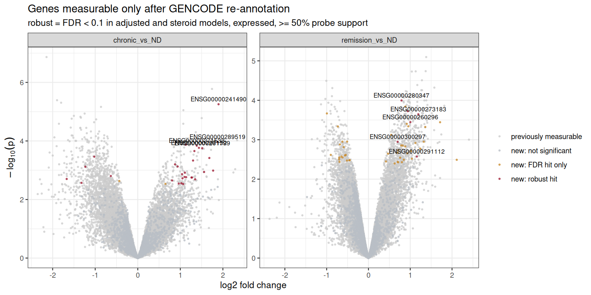

## 3. Variant layer

GWAS GCST90018865: lambda_GC = 1.012; 0 variants at p<5e-8; loci defined as **independent leads with p < 1e-06**.

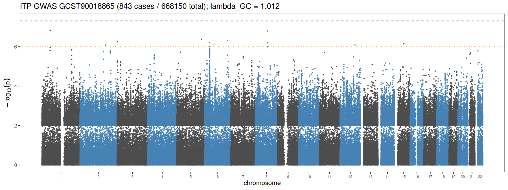

| locus | chr | lead_pos | lead_rsid | effect_allele | other_allele | beta | se | p | maf | start | end | mhc | genes_in_window |
|---|---|---|---|---|---|---|---|---|---|---|---|---|---|
| L1 |    1 | 54224735 | rs573928622 | C | G |  2.8 | 0.532 | 1.50e-07 | 0.0129 | 53724735 | 54724735 | FALSE | SSBP3-AS1,MRPL37,CYB5RL,ENSG00000256407,SSBP3-AS2,CDCP2,ENSG00000280425,SSBP3,ENSG00000299198,TCEANC2,TMEM59,ENSG00000232245,LDLRAD1,ENSG00000305454,ENSG00000304716 |
| L2 |    8 | 78998928 | rs113868754 | T | C | 0.888 | 0.17 | 1.60e-07 | 0.0311 | 78498928 | 79498928 | FALSE | ENSG00000309889,MITA1,LINC02605,ENSG00000307502,IL7,ENSG00000296852,ENSG00000253659,ENSG00000299650,ZC2HC1A,ENSG00000260398,PKIA,ENSG00000286675,PKIA-AS1 |
| L3 |    5 | 159821843 | rs112156751 | T | C |  1.4 | 0.278 | 4.24e-07 | 0.0133 | 159321843 | 160321843 | FALSE | LINC01847,ADRA1B,ENSG00000306315,TTC1,PWWP2A,IL12B-AS1,ENSG00000283413,ENSG00000301595,ENSG00000301645,LINC01845,ENSG00000301614,FABP6-AS1,FABP6,CCNJL,IL12B |
| L4 |    6 | 149168046 | rs35733790 | C | T | 0.464 | 0.0921 | 4.77e-07 | 0.175 | 148668046 | 149668046 | FALSE | ENSG00000289359,ENSG00000308559,ENSG00000308521,ENSG00000228408,ENSG00000308546,TAB2-AS1,ENSG00000283608,UST-AS2,TAB2,UST-AS1,SUMO4,UST,ZC3H12D,ENSG00000289045,PPIL4 |
| L5 |    3 | 835693 | rs140270179 | T | G | 1.82 | 0.363 | 5.61e-07 | 0.00785 | 335693 | 1335693 | FALSE | ENSG00000224239,LINC01266,ENSG00000235158,ENSG00000287505,ENSG00000303063,ENSG00000300434,ENSG00000296391,CNTN6,CHL1-AS1,CHL1 |
| L6 |    6 | 32725352 | rs9275950 | T | C | -0.263 | 0.0527 | 6.29e-07 | 0.415 | 32225352 | 33225352 | TRUE | ENSG00000232080,HLA-DQA2,HLA-DQB2,ENSG00000302994,ENSG00000303029,HLA-DQB1-AS1,ENSG00000302653,HLA-DQB1,HLA-DQA1,HLA-DOB,ENSG00000307274,ENSG00000250264,ENSG00000309733,TAP2,PSMB8 |
| L7 |   15 | 60828567 | rs1384122 | T | C | 0.26 | 0.0525 | 7.11e-07 | 0.327 | 60328567 | 61328567 | FALSE | ENSG00000273792,RORA,RORA-AS4,RORA-AS2,ENSG00000287508,ENSG00000286457,ENSG00000273958,ENSG00000309525,RORA-AS1,RORA-AS3,ICE2,ENSG00000259575,ENSG00000309503,ENSG00000276473,ENSG00000306198 |
| L8 |   12 | 97352074 | rs553064317 | A | C | 1.63 | 0.33 | 8.24e-07 | 0.0104 | 96852074 | 97852074 | FALSE | LINC02409,ENSG00000301349,RMST,ENSG00000300902,ENSG00000286434,ENSG00000257470,ENSG00000293845,PAFAH1B2P2,NEDD1,CFAP54 |
| L9 |    2 | 165666336 | rs368703159 | A | AAGAG | 0.446 | 0.0906 | 8.31e-07 | 0.183 | 165166336 | 166166336 | FALSE | ENSG00000293576,ENSG00000293580,ENSG00000307262,CSRNP3,GALNT3,ENSG00000229195,ENSG00000235192,ENSG00000288089,TTC21B,TTC21B-AS1,SCN2A,SCN1A,SCN1A-AS1,SCN3A,ENSG00000236283 |

### TWAS (whole blood)

12358 genes tested; 0 at FDR<0.10; 0 Bonferroni-significant.

| model_gene | z | n_snps_used | gene_id | n_snps_model | p | fdr | bonferroni_sig | symbol | chr | start |
|---|---|---|---|---|---|---|---|---|---|---|
| ENSG00000139324.11 | 4.42 |    1 | ENSG00000139324 |    1 | 9.93e-06 | 0.123 | FALSE | TMTC3 |   12 | 88142181 |
| ENSG00000260314.2 | -3.99 |    1 | ENSG00000260314 |    1 | 6.68e-05 | 0.413 | FALSE | MRC1 |   10 | 17809014 |
| ENSG00000124383.8 | -3.77 |    2 | ENSG00000124383 |    2 | 1.66e-04 | 0.618 | FALSE | MPHOSPH10 |    2 | 71130305 |
| ENSG00000251580.1 | 3.69 |    1 | ENSG00000251580 |    1 | 2.28e-04 | 0.618 | FALSE | LINC02482 |    4 | 6648695 |
| ENSG00000244731.7 | -3.55 |    2 | ENSG00000244731 |    2 | 3.80e-04 | 0.618 | FALSE | C4A |    6 | 31981991 |
| ENSG00000134755.14 | -3.54 |    1 | ENSG00000134755 |    2 | 4.01e-04 | 0.618 | FALSE | DSC2 |   18 | 31058545 |
| ENSG00000213719.8 | -3.52 |    1 | ENSG00000213719 |    1 | 4.32e-04 | 0.618 | FALSE | CLIC1 |    6 | 31730579 |
| ENSG00000224389.8 | 3.51 |    2 | ENSG00000224389 |    2 | 4.41e-04 | 0.618 | FALSE | C4B |    6 | 32014725 |
| ENSG00000111358.13 |  3.5 |    1 | ENSG00000111358 |    1 | 4.66e-04 | 0.618 | FALSE | GTF2H3 |   12 | 123633739 |
| ENSG00000204386.10 | -3.45 |    2 | ENSG00000204386 |    2 | 5.62e-04 | 0.618 | FALSE | NEU1 |    6 | 31857063 |
| ENSG00000166278.14 | 3.42 |    1 | ENSG00000166278 |    1 | 6.35e-04 | 0.618 | FALSE | C2 |    6 | 31897785 |
| ENSG00000141337.12 | -3.41 |    1 | ENSG00000141337 |    1 | 6.55e-04 | 0.618 | FALSE | ARSG |   17 | 68259170 |
| ENSG00000204444.10 | -3.38 |    2 | ENSG00000204444 |    2 | 7.23e-04 | 0.618 | FALSE | APOM |    6 | 31652416 |
| ENSG00000268355.1 | 3.35 |    1 | ENSG00000268355 |    2 | 8.13e-04 | 0.618 | FALSE | AC006129.1 | NA | NA |
| ENSG00000126266.3 | 3.32 |    1 | ENSG00000126266 |    1 | 9.15e-04 | 0.618 | FALSE | FFAR1 |   19 | 35347902 |
| ENSG00000117724.12 | 3.31 |    2 | ENSG00000117724 |    2 | 9.22e-04 | 0.618 | FALSE | CENPF |    1 | 214603172 |
| ENSG00000188649.12 | 3.31 |    4 | ENSG00000188649 |    4 | 9.37e-04 | 0.618 | FALSE | CC2D2B |   10 | 95907603 |
| ENSG00000138363.14 | -3.31 |    2 | ENSG00000138363 |    2 | 9.45e-04 | 0.618 | FALSE | ATIC |    2 | 215311956 |
| ENSG00000188130.13 |  3.3 |    3 | ENSG00000188130 |    3 | 9.51e-04 | 0.618 | FALSE | MAPK12 |   22 | 50245186 |
| ENSG00000122203.14 | 3.29 |    2 | ENSG00000122203 |    2 | 0.00102 | 0.621 | FALSE | KIAA1191 |    5 | 176339650 |

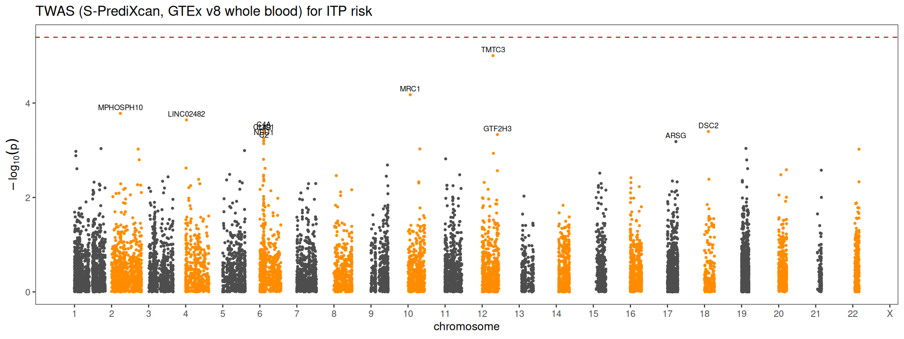

### Colocalisation

131 locus-gene-tissue tests; 2 with PP.H4 > 0.5 (shared causal variant): HLA-C (GTEx_v10_whole_blood), HLA-C (BLUEPRINT_CD4_T_cell). **[auto]** All of them lie in the MHC, where extreme LD and HLA allelic diversity make single-variant colocalisation unreliable; they are reported but should not be read as causal-gene evidence without HLA-specific fine-mapping. **[auto]** 0 of these 2 pass the credibility check (best GWAS p among the shared SNPs < 1e-05); only credible results count towards filter F4.

| locus | chr | lead_rsid | lead_p | mhc | eqtl_dataset | gene_id | nsnps | gwas_min_p_shared | credible | PP.H0 | PP.H1 | PP.H2 | PP.H3 | PP.H4 | top_snp | top_snp_PP4 | risk_allele_raises_expression | symbol |
|---|---|---|---|---|---|---|---|---|---|---|---|---|---|---|---|---|---|---|
| L6 |    6 | rs9275950 | 6.29e-07 | TRUE | GTEx_v10_whole_blood | ENSG00000204525 |  515 | 6.17e-05 | FALSE | 1.09e-08 | 2.65e-09 | 0.138 | 0.0327 | 0.83 | 32226853_G_C | 0.307 | TRUE | HLA-C |
| L6 |    6 | rs9275950 | 6.29e-07 | TRUE | BLUEPRINT_CD4_T_cell | ENSG00000204525 |  487 | 6.17e-05 | FALSE | 5.66e-06 | 1.42e-06 | 0.297 | 0.0737 | 0.63 | 32249315_T_C | 0.801 | TRUE | HLA-C |
| L6 |    6 | rs9275950 | 6.29e-07 | TRUE | GTEx_v10_whole_blood | ENSG00000234745 | 1213 | 4.26e-05 | FALSE | 0.0685 | 0.0466 | 0.293 | 0.199 | 0.393 | 32249315_T_C | 0.538 | TRUE | HLA-B |
| L6 |    6 | rs9275950 | 6.29e-07 | TRUE | GTEx_v10_whole_blood | ENSG00000272221 | 1620 | 4.26e-05 | FALSE | 0.00261 | 0.0024 | 0.335 | 0.308 | 0.352 | 32226818_A_C | 0.726 | TRUE | MICA-AS1 |
| L6 |    6 | rs9275950 | 6.29e-07 | TRUE | GTEx_v10_whole_blood | ENSG00000204428 | 6906 | 2.17e-06 | TRUE | 0.0024 | 0.019 | 0.0764 | 0.603 | 0.299 | 32606583_C_T | 0.0794 | TRUE | LY6G5C |
| L6 |    6 | rs9275950 | 6.29e-07 | TRUE | BLUEPRINT_CD4_T_cell | ENSG00000234745 | 1071 | 4.26e-05 | FALSE | 0.0184 | 0.0125 | 0.409 | 0.278 | 0.282 | 32249315_T_C | 0.55 | TRUE | HLA-B |
| L6 |    6 | rs9275950 | 6.29e-07 | TRUE | BLUEPRINT_CD4_T_cell | ENSG00000030110 | 10662 | 6.29e-07 | TRUE | 0.0069 | 0.272 | 0.0123 | 0.485 | 0.224 | 32725352_C_T | 0.0664 | TRUE | BAK1 |
| L6 |    6 | rs9275950 | 6.29e-07 | TRUE | GTEx_v10_whole_blood | ENSG00000204444 | 5861 | 2.17e-06 | TRUE | 0.0462 | 0.348 | 0.0479 | 0.361 | 0.197 | 32616054_G_C | 0.275 | FALSE | APOM |
| L6 |    6 | rs9275950 | 6.29e-07 | TRUE | BLUEPRINT_CD4_T_cell | ENSG00000289375 | 4842 | 1.37e-06 | TRUE | 0.0246 | 0.261 | 0.0463 | 0.491 | 0.177 | 32616054_G_C | 0.0527 | FALSE | ENSG00000289375 |
| L6 |    6 | rs9275950 | 6.29e-07 | TRUE | GTEx_v10_whole_blood | ENSG00000213719 | 8844 | 6.29e-07 | TRUE | 0.00314 | 0.118 | 0.0183 | 0.689 | 0.171 | 32316331_T_G | 0.0387 | FALSE | CLIC1 |
| L6 |    6 | rs9275950 | 6.29e-07 | TRUE | GTEx_v10_whole_blood | ENSG00000286940 | 2857 | 2.17e-06 | TRUE | 0.0811 | 0.452 | 0.0468 | 0.26 | 0.16 | 32446513_A_G | 0.547 | TRUE | MICB-DT |
| L6 |    6 | rs9275950 | 6.29e-07 | TRUE | BLUEPRINT_CD4_T_cell | ENSG00000272221 | 1461 | 4.26e-05 | FALSE | 0.186 | 0.172 | 0.256 | 0.237 | 0.149 | 32372063_T_A | 0.431 | TRUE | MICA-AS1 |
| L6 |    6 | rs9275950 | 6.29e-07 | TRUE | BLUEPRINT_CD4_T_cell | ENSG00000198563 | 2904 | 1.37e-06 | TRUE | 0.0643 | 0.573 | 0.0234 | 0.209 | 0.13 | 32486584_C_T | 0.163 | FALSE | DDX39B |
| L6 |    6 | rs9275950 | 6.29e-07 | TRUE | GTEx_v10_whole_blood | ENSG00000204386 | 10339 | 6.29e-07 | TRUE | 0.00432 | 0.193 | 0.015 | 0.668 | 0.12 | 32486501_C_T | 0.178 | FALSE | NEU1 |
| L6 |    6 | rs9275950 | 6.29e-07 | TRUE | GTEx_v10_whole_blood | ENSG00000204520 | 1640 | 4.26e-05 | FALSE | 0.267 | 0.248 | 0.192 | 0.177 | 0.116 | 32371771_G_A | 0.584 | TRUE | MICA |
| L6 |    6 | rs9275950 | 6.29e-07 | TRUE | BLUEPRINT_CD4_T_cell | ENSG00000204308 | 13720 | 6.29e-07 | TRUE | 0.0106 | 0.392 | 0.0131 | 0.486 | 0.0981 | 32725352_C_T | 0.0444 | TRUE | RNF5 |
| L6 |    6 | rs9275950 | 6.29e-07 | TRUE | BLUEPRINT_CD4_T_cell | ENSG00000232940 | 13569 | 6.29e-07 | TRUE | 0.0119 | 0.447 | 0.0116 | 0.436 | 0.0938 | 32725352_C_T | 0.0624 | FALSE | HCG25 |
| L6 |    6 | rs9275950 | 6.29e-07 | TRUE | BLUEPRINT_CD4_T_cell | ENSG00000204252 | 13829 | 6.29e-07 | TRUE | 0.0117 | 0.432 | 0.0124 | 0.457 | 0.0864 | 32725352_C_T | 0.0458 | FALSE | HLA-DOA |
| L6 |    6 | rs9275950 | 6.29e-07 | TRUE | GTEx_v10_whole_blood | ENSG00000204351 | 10858 | 6.29e-07 | TRUE | 0.00145 | 0.0618 | 0.0197 | 0.839 | 0.0778 | 32616054_G_C | 0.0475 | FALSE | SKIC2 |
| L6 |    6 | rs9275950 | 6.29e-07 | TRUE | BLUEPRINT_CD4_T_cell | ENSG00000227057 | 13263 | 6.29e-07 | TRUE | 0.0115 | 0.439 | 0.012 | 0.46 | 0.0775 | 32725352_C_T | 0.0723 | TRUE | WDR46 |

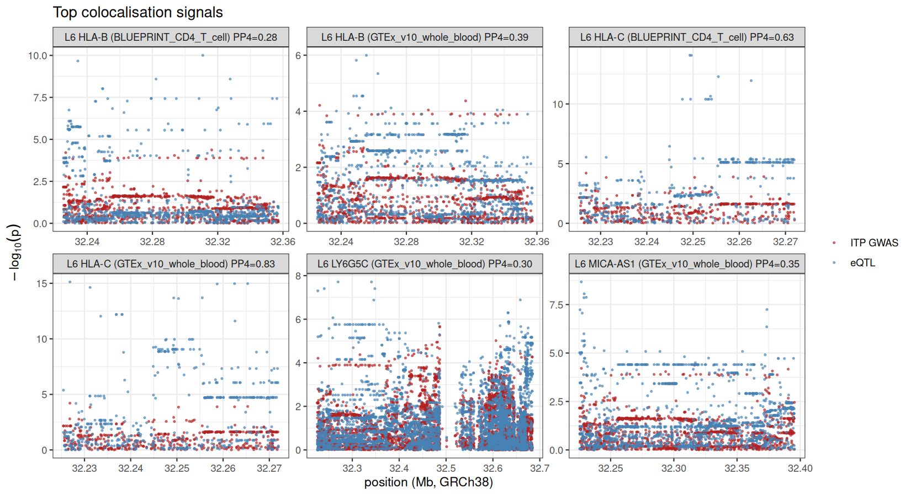

### Replication GWAS

Not run: provide the replication file's download link as the repository secret `REPLICATION_GWAS_URL`.

_(not available: upstream step did not run)_

_(not available: upstream step did not run)_

## 4. Integration

Formal tests of whether genetic evidence and chronicity expression converge more than chance:

| test | n_universe | n_set | n_overlap | expected | odds_ratio | p | direction |
|---|---|---|---|---|---|---|---|
| Fisher overlap: top 1% TWAS genes (too few F4 genes) vs F1 | 10391 |  104 | 0 | 0.67 | 0 |    1 | NA |
| Fisher overlap: top 1% TWAS genes (too few F4 genes) vs F2 | 10391 |  104 |   17 | 21.8 | 0.735 | 0.903 | NA |
| Fisher overlap: top 1% TWAS genes (too few F4 genes) vs F3 | 10391 |  104 |    2 | 3.44 | 0.57 | 0.864 | NA |
| cameraPR: top 1% TWAS genes (too few F4 genes) in F1 | 8119 |   83 | NA | NA | NA | 0.603 | Down |
| cameraPR: top 1% TWAS genes (too few F4 genes) in F2 | 10391 |  104 | NA | NA | NA | 0.826 | Up |
| cameraPR: top 1% TWAS genes (too few F4 genes) in F3 | 10391 |  104 | NA | NA | NA | 0.19 | Up |
| Spearman TWAS z vs t F1 | 8119 | NA | NA | NA | 0.0196 | 0.077 | NA |
| Spearman TWAS z vs t F2 | 10391 | NA | NA | NA | 0.0173 | 0.0776 | NA |
| Spearman TWAS z vs t F3 | 10391 | NA | NA | NA | 0.02 | 0.041 | NA |
| A priori: F2 BH-FDR<0.1 within top 1% TWAS genes (too few F4 genes) |  104 |  104 |    8 | NA | NA | 0.0508 | NA |

**[auto]** 1 of 10 convergence tests reach nominal p<0.05 (Spearman TWAS z vs t F3); none survive Bonferroni correction for 10 tests (p<0.0050). Treat the convergence as not established.

Top candidate genes (ranked by number of filters passed, then combined p):

| gene_id | logFC_F1 | t_F1 | p_F1 | logFC_F2 | t_F2 | p_F2 | logFC_F3 | t_F3 | p_F3 | symbol | F1 | F2 | F3 | F1_same_direction_as_F2 | module | module_concordant | twas_z | twas_p | twas_fdr | coloc_PP4 | coloc_dataset | coloc_locus | risk_allele_raises_expression | in_gwas_locus | F4 | evidence_score | genetic_expression_direction_agree | combined_p |
|---|---|---|---|---|---|---|---|---|---|---|---|---|---|---|---|---|---|---|---|---|---|---|---|---|---|---|---|---|
| ENSG00000260314 | NA | NA | NA | -0.85 | -2.29 | 0.0399 | 0.484 | 3.56 | 0.00766 | MRC1 | FALSE | TRUE | TRUE | NA | tan | TRUE | -3.99 | 6.68e-05 | 0.413 | NA | NA | NA | NA | FALSE | FALSE |    2 | TRUE | 3.58e-06 |
| ENSG00000143740 | -0.502 | -2.28 | 0.0311 | -1.23 | -5.62 | 8.70e-05 | -0.577 | -3.35 | 0.0103 | SNAP47 | TRUE | TRUE | FALSE | TRUE | blue | FALSE | 1.31 | 0.189 | 0.971 | NA | NA | NA | NA | FALSE | FALSE |    2 | FALSE | 7.15e-06 |
| ENSG00000074071 | -0.354 | -2.06 | 0.0497 | -0.717 | -3.13 | 0.0081 | -0.825 | -5.57 | 5.68e-04 | MRPS34 | TRUE | TRUE | FALSE | TRUE | NA | NA | -1.18 | 0.238 | 0.981 | NA | NA | NA | NA | FALSE | FALSE |    2 | TRUE | 5.11e-05 |
| ENSG00000132740 | -0.401 | -2.2 | 0.0373 | -0.694 | -3.6 | 0.00331 | -0.547 | -4.34 | 0.00261 | IGHMBP2 | TRUE | TRUE | FALSE | TRUE | NA | NA | 0.912 | 0.362 | 0.989 | NA | NA | NA | NA | FALSE | FALSE |    2 | FALSE | 9.58e-05 |
| ENSG00000198814 | 0.838 | 3.24 | 0.00329 | 1.11 | 2.42 | 0.0309 | 0.901 | 3.41 | 0.00956 | GK | TRUE | TRUE | FALSE | TRUE | pink | FALSE | NA | NA | NA | NA | NA | NA | NA | FALSE | FALSE |    2 | NA | 1.08e-04 |
| ENSG00000070269 | 0.368 | 2.25 | 0.0331 | 0.495 | 2.26 | 0.0415 | 0.901 | 5.35 | 7.31e-04 | TMEM260 | TRUE | TRUE | FALSE | TRUE | turquoise | FALSE | NA | NA | NA | NA | NA | NA | NA | FALSE | FALSE |    2 | NA | 1.11e-04 |
| ENSG00000188997 | -0.246 | -2.14 | 0.0417 | -0.829 | -2.4 | 0.0323 | -1.05 | -5.27 | 8.08e-04 | KCTD21 | TRUE | TRUE | FALSE | TRUE | blue | FALSE | -1.32 | 0.185 | 0.967 | NA | NA | NA | NA | FALSE | FALSE |    2 | TRUE | 1.50e-04 |
| ENSG00000156990 | 0.0196 | 0.0844 | 0.933 | -1.56 | -4.53 | 5.79e-04 | 0.598 | 3.28 | 0.0115 | RPUSD3 | FALSE | TRUE | TRUE | FALSE | blue | FALSE | -1.16 | 0.245 | 0.982 | NA | NA | NA | NA | FALSE | FALSE |    2 | TRUE | 7.69e-04 |
| ENSG00000103066 | -0.443 | -2.12 | 0.0439 | -0.483 | -3.25 | 0.0064 | -0.303 | -2.82 | 0.0228 | PLA2G15 | TRUE | TRUE | FALSE | TRUE | NA | NA | 0.944 | 0.345 | 0.989 | NA | NA | NA | NA | FALSE | FALSE |    2 | FALSE | 0.00103 |
| ENSG00000066279 | NA | NA | NA | -1.58 | -2.82 | 0.0145 | 0.783 | 3.37 | 0.01 | ASPM | FALSE | TRUE | TRUE | NA | tan | TRUE | NA | NA | NA | NA | NA | NA | NA | FALSE | FALSE |    2 | NA | 0.00143 |
| ENSG00000163832 | -0.329 | -2.18 | 0.0382 | -0.566 | -3.73 | 0.00256 | -0.28 | -1.84 | 0.104 | ELP6 | TRUE | TRUE | FALSE | TRUE | NA | NA | 0.508 | 0.611 | 0.994 | NA | NA | NA | NA | FALSE | FALSE |    2 | FALSE | 0.00232 |
| ENSG00000270012 | NA | NA | NA | 0.636 | 3.33 | 0.00546 | -0.297 | -2.32 | 0.0493 | ENSG00000270012 | FALSE | TRUE | TRUE | NA | NA | NA | NA | NA | NA | NA | NA | NA | NA | FALSE | FALSE |    2 | NA | 0.00248 |
| ENSG00000196338 | 0.916 | 2.18 | 0.0393 | 1.16 |  4.1 | 0.00128 | 0.0696 | 0.241 | 0.816 | NLGN3 | TRUE | TRUE | FALSE | TRUE | pink | FALSE | NA | NA | NA | NA | NA | NA | NA | FALSE | FALSE |    2 | NA | 0.00255 |
| ENSG00000092853 | NA | NA | NA | -0.699 | -3.18 | 0.00739 | 0.451 | 2.42 | 0.0427 | CLSPN | FALSE | TRUE | TRUE | NA | tan | TRUE | NA | NA | NA | NA | NA | NA | NA | FALSE | FALSE |    2 | NA | 0.00286 |
| ENSG00000166845 | -0.633 | -2.99 | 0.00612 | -0.0215 | -0.0424 | 0.967 | 0.709 | 4.34 | 0.0026 | C18orf54 | TRUE | FALSE | TRUE | TRUE | turquoise | FALSE | -0.608 | 0.543 | 0.994 | NA | NA | NA | NA | FALSE | FALSE |    2 | TRUE | 0.0029 |
| ENSG00000143157 | -0.0861 | -0.49 | 0.629 | 0.656 | 3.56 | 0.00352 | -0.341 | -2.75 | 0.0256 | POGK | FALSE | TRUE | TRUE | FALSE | NA | NA | NA | NA | NA | NA | NA | NA | NA | FALSE | FALSE |    2 | NA | 0.00333 |
| ENSG00000138613 | 0.442 | 2.28 | 0.0309 | 0.662 | 3.45 | 0.0044 | 0.233 | 1.65 | 0.138 | APH1B | TRUE | TRUE | FALSE | TRUE | NA | NA | -0.536 | 0.592 | 0.994 | NA | NA | NA | NA | FALSE | FALSE |    2 | FALSE | 0.00362 |
| ENSG00000166669 | 0.415 | 2.31 | 0.0294 | 0.437 | 2.34 | 0.0363 | 0.304 | 3.02 | 0.0169 | ATF7IP2 | TRUE | TRUE | FALSE | TRUE | NA | NA | 0.468 | 0.639 | 0.994 | NA | NA | NA | NA | FALSE | FALSE |    2 | TRUE | 0.00372 |
| ENSG00000022267 | 0.564 | 2.48 | 0.0199 | 0.609 |  1.6 | 0.134 | -0.264 | -2.74 | 0.0258 | FHL1 | TRUE | FALSE | TRUE | TRUE | brown | FALSE | NA | NA | NA | NA | NA | NA | NA | FALSE | FALSE |    2 | NA | 0.00389 |
| ENSG00000064726 | -0.525 | -2.67 | 0.0128 | -0.064 | -0.307 | 0.764 | 0.39 | 2.96 | 0.0184 | BTBD1 | TRUE | FALSE | TRUE | TRUE | NA | NA | -1.71 | 0.088 | 0.967 | NA | NA | NA | NA | FALSE | FALSE |    2 | TRUE | 0.00473 |
| ENSG00000132938 | 0.599 | 3.12 | 0.00501 | 0.0463 | 0.16 | 0.876 | -0.319 | -2.89 | 0.0206 | MTUS2 | TRUE | FALSE | TRUE | TRUE | NA | NA | NA | NA | NA | NA | NA | NA | NA | FALSE | FALSE |    2 | NA | 0.00485 |
| ENSG00000102471 | -0.333 | -2.19 | 0.0376 | -0.635 | -3.35 | 0.0053 | -0.0497 | -0.199 | 0.848 | NDFIP2 | TRUE | TRUE | FALSE | TRUE | NA | NA | 1.63 | 0.104 | 0.967 | NA | NA | NA | NA | FALSE | FALSE |    2 | FALSE | 0.00511 |
| ENSG00000145721 | 0.386 | 2.65 | 0.0134 | 0.567 | 2.68 | 0.019 | 0.372 | 0.931 | 0.38 | LIX1 | TRUE | TRUE | FALSE | TRUE | red | FALSE | NA | NA | NA | NA | NA | NA | NA | FALSE | FALSE |    2 | NA | 0.00512 |
| ENSG00000138180 | 0.335 | 1.69 | 0.103 | -1.58 | -2.85 | 0.0139 | 0.726 | 2.76 | 0.025 | CEP55 | FALSE | TRUE | TRUE | FALSE | tan | TRUE | 0.64 | 0.522 | 0.994 | NA | NA | NA | NA | FALSE | FALSE |    2 | FALSE | 0.00536 |
| ENSG00000183395 | NA | NA | NA | -0.45 | -2.27 | 0.0409 |  0.5 | 2.77 | 0.0248 | PMCH | FALSE | TRUE | TRUE | NA | NA | NA | NA | NA | NA | NA | NA | NA | NA | FALSE | FALSE |    2 | NA | 0.00803 |
| ENSG00000162623 | -0.41 | -2.55 | 0.0175 | -0.75 | -3.54 | 0.00372 | -0.043 | -0.22 | 0.831 | TYW3 | TRUE | TRUE | FALSE | TRUE | NA | NA | 0.387 | 0.698 | 0.994 | NA | NA | NA | NA | FALSE | FALSE |    2 | FALSE | 0.00903 |
| ENSG00000185338 | 0.435 | 2.26 | 0.0323 | 0.407 | 0.99 | 0.34 | -0.718 | -3.01 | 0.0173 | SOCS1 | TRUE | FALSE | TRUE | TRUE | brown | FALSE | 1.24 | 0.214 | 0.98 | NA | NA | NA | NA | FALSE | FALSE |    2 | TRUE | 0.00954 |
| ENSG00000196632 | 0.00391 | 0.0196 | 0.984 | 0.814 | 2.35 | 0.0357 | -0.767 | -3.59 | 0.00734 | WNK3 | FALSE | TRUE | TRUE | TRUE | brown | FALSE | NA | NA | NA | NA | NA | NA | NA | FALSE | FALSE |    2 | NA | 0.0112 |
| ENSG00000100346 | 0.586 | 2.53 | 0.018 | 0.273 | 0.826 | 0.424 | -0.68 | -2.32 | 0.0499 | CACNA1I | TRUE | FALSE | TRUE | TRUE | brown | FALSE | NA | NA | NA | NA | NA | NA | NA | FALSE | FALSE |    2 | NA | 0.0152 |
| ENSG00000196411 | 0.00754 | 0.0365 | 0.971 | 0.833 | 3.23 | 0.00667 | -0.62 | -2.73 | 0.0264 | EPHB4 | FALSE | TRUE | TRUE | TRUE | brown | FALSE | -0.587 | 0.557 | 0.994 | NA | NA | NA | NA | FALSE | FALSE |    2 | FALSE | 0.0177 |

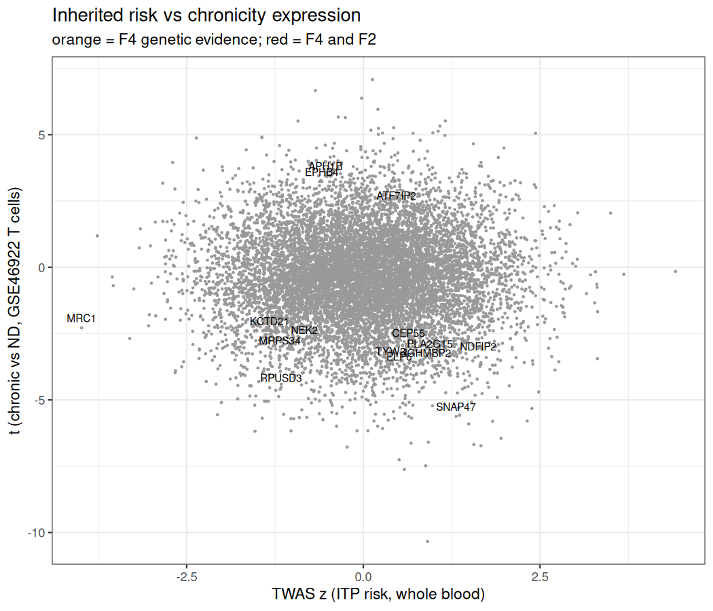

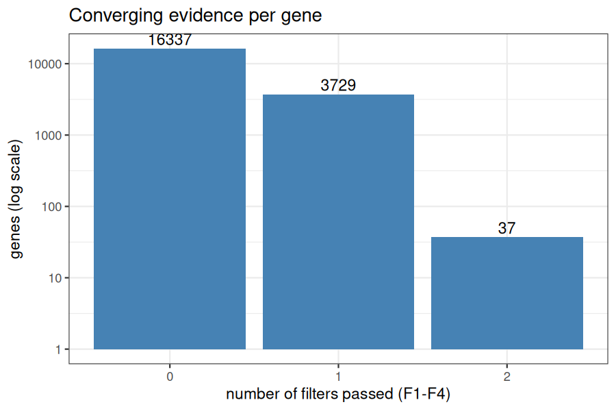

## 5. Benchmark (GSE23754, signatures trained on GPL570 only)

| task | model | n | n_cases | AUC | CI_low | CI_high | permutation_p | random_geneset_p | beats_chance |
|---|---|---|---|---|---|---|---|---|---|
| T1_progression_vs_acute | platelet_score_only |   12 |    4 | 0.25 | 0 | 0.74 | 0.926 | NA | FALSE |
| T1_progression_vs_acute | Tcell_signature_GSE46922 |   12 |    4 | 0.344 | 0 | 0.709 | 0.824 | 0.804 | FALSE |
| T1_progression_vs_acute | integrated_signature |   12 |    4 | 0.531 | 0.174 | 0.888 | 0.466 | 0.458 | FALSE |
| T1_progression_vs_acute | module_pink |   12 |    4 | 0.438 | 0.0749 |  0.8 | 0.665 | NA | FALSE |
| T1_progression_vs_acute | baseline_logistic_LOOCV |   12 |    4 | 0.531 | 0.0804 | 0.982 | 0.468 | NA | FALSE |
| T1_progression_vs_acute | baseline_plus_Tcell_signature_LOOCV |   12 |    4 | 0.531 | 0.105 | 0.958 | 0.496 | NA | FALSE |
| T1_progression_vs_acute | within_cohort_elastic_net_nestedLOOCV |   12 |    4 | 0.438 | 0.0182 | 0.857 | 0.66 | NA | FALSE |
| T2_eventual_chronic_vs_acute | platelet_score_only |   26 |   18 | 0.292 | 0.0911 | 0.492 | 0.953 | NA | FALSE |
| T2_eventual_chronic_vs_acute | Tcell_signature_GSE46922 |   26 |   18 | 0.424 | 0.16 | 0.687 | 0.733 | 0.72 | FALSE |
| T2_eventual_chronic_vs_acute | integrated_signature |   26 |   18 | 0.597 | 0.288 | 0.906 | 0.228 | 0.298 | FALSE |
| T2_eventual_chronic_vs_acute | module_pink |   26 |   18 | 0.375 | 0.104 | 0.646 | 0.837 | NA | FALSE |
| T2_eventual_chronic_vs_acute | baseline_logistic_LOOCV |   26 |   18 | 0.764 | 0.517 |    1 | 0.0205 | NA | TRUE |
| T2_eventual_chronic_vs_acute | baseline_plus_Tcell_signature_LOOCV |   26 |   18 | 0.715 | 0.467 | 0.964 | 0.05 | NA | FALSE |
| T2_eventual_chronic_vs_acute | within_cohort_elastic_net_nestedLOOCV |   26 |   18 |  0.5 | 0.242 | 0.758 | 0.516 | NA | FALSE |

**[auto]** Primary task T1 has 12 samples ( 4 progressors). Baseline AUC = 0.53; best model = integrated_signature (AUC 0.53, 95% CI 0.17-0.89, permutation p = 0.466). No model's confidence interval excludes 0.5; with 4 progressors this benchmark cannot distinguish a real signature from chance, which is the expected and reportable result at this n. In secondary task T2 (confounded by disease duration), only baseline_logistic_LOOCV beats chance (AUC 0.76, CI 0.52-1.00); transcriptomic signatures add nothing beyond it.

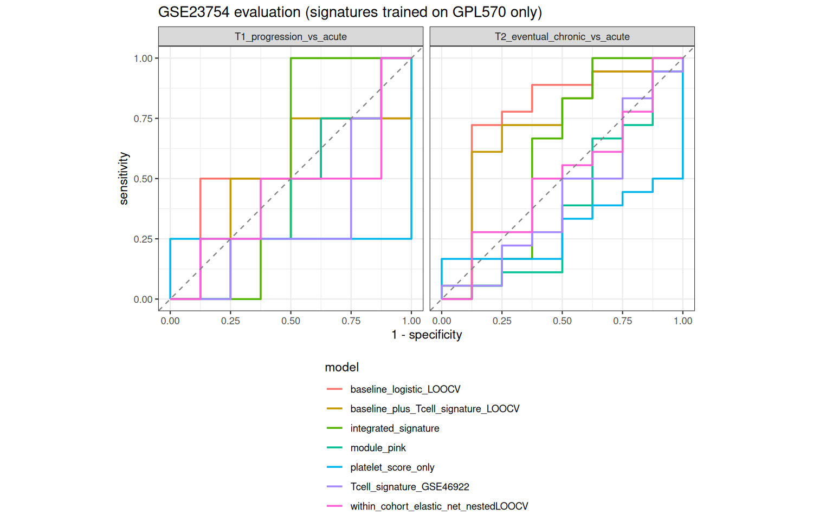

## 6. Limitations stated by the design

- The GWAS phenotype is ITP *susceptibility* in mostly adult biobank participants, not pediatric chronicity.
- GSE23754 used a pre-2009 6-month definition of chronic ITP; 'progression' samples are the only ones drawn before outcome.
- GEO provides no per-sample age, sex, platelet count or treatment for these series; sex and platelet burden are inferred from expression.
- GSE46922/GSE56232 are sorted T cells; GSE23754 is whole blood on a different platform: cross-cohort agreement is tested, not assumed.
- Time-to-remission (survival) modelling would be stronger but no public dataset links transcriptomes to follow-up time.

See `docs/PROJECT_PLAN.md` for the full rationale.
